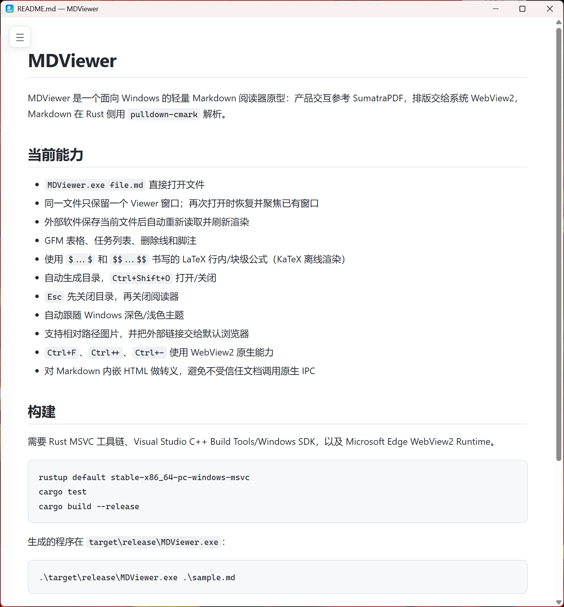

<p align="center">
  
</p>

<h1 align="center">Markdown Viewer</h1>

<p align="center">简体中文 · <a href="README.en.md">English</a></p>

<p align="center"><strong>轻量 Windows Markdown 阅读器，支持离线数学公式与自动目录。</strong></p>

<p align="center">
  <a href="https://github.com/yuzhounh/markdown-viewer/releases/latest"></a>
  <a href="LICENSE"></a>
  
  
</p>

<p align="center">
  <a href="https://github.com/yuzhounh/markdown-viewer/releases/latest">下载发布版</a> · <a href="#快速开始">快速开始</a> · <a href="LICENSE">开源协议</a>
</p>

Markdown Viewer 是一个专为 Windows 设计的轻量 Markdown 阅读器：交互参考 SumatraPDF 极简直觉体验，排版交给系统内置的 WebView2，底层通过 Rust `pulldown-cmark` 解析，并原生支持 KaTeX 数学公式与自动生成目录。

<p align="center">
  
</p>

## 功能特点

- `MarkdownViewer.exe file.md` 直接打开文件
- 固定使用标签模式，拖出标签仍可建立独立窗口；切换及跨窗移动保留文档、阅读位置和目录状态
- 同一文件只打开一份；再次打开时恢复并聚焦已有标签页或窗口
- 使用 Chromium 风格的 40 DIP 自绘标题标签栏与 46 × 40 DIP 窗口按钮；图标按物理像素绘制，保留 Windows 系统命令及 Snap 命中
- 拖动标签可调整顺序；拖离标签栏并松手可建立独立窗口，拖至另一个 Markdown Viewer 的标签栏可按落点合并。只有一个标签时，拖出会移动原窗口；合并后自动关闭空窗口
- 拖动时显示预览与插入位置，标签随数量压缩以显示在栏内；空间不足时保留图标并通过悬停提示识别完整路径，`Esc` 可取消正在进行的拖动
- 左侧下箭头打开标签搜索面板，筛选已打开文档及最近文件（最近 8 项，排除已打开文档）；方向键及 Enter 选择，Esc 或点击外部关闭
- `Ctrl+O` 或标签末尾 `＋` 多选打开文件，也可拖入文件；命令行支持一次传入多个文件
- `Ctrl+Tab` / `Ctrl+Shift+Tab`（或 `Ctrl+PageDown` / `Ctrl+PageUp`）切换标签，`Ctrl+1…8` 选择对应标签，`Ctrl+9` 选择最后一页，`Ctrl+W` 关闭当前页
- 通过系统文件变化通知自动刷新；空闲时不轮询读取全文，保存时防抖并兼容临时文件替换
- GFM 表格、任务列表、删除线和脚注
- 使用 `$...$` 和 `$$...$$` 书写的 LaTeX 行内/块级公式（KaTeX 离线渲染）
- 自动生成目录，仅用 `Ctrl+B` 打开/关闭，无常驻目录按钮
- `Esc` 先关闭目录，再关闭当前页；关闭最后一页时退出窗口
- 自动跟随 Windows 深色/浅色主题
- 支持相对路径图片，并把外部链接交给默认浏览器
- `Ctrl+F`、`Ctrl++`、`Ctrl+-` 使用 WebView2 原生能力
- 对 Markdown 内嵌 HTML 进行安全白名单过滤，保留排版标签同时防止脚本调用原生 IPC

## 快速开始

需要 Rust MSVC 工具链、Visual Studio C++ Build Tools/Windows SDK、Microsoft Edge WebView2 Runtime 和 Windows App Runtime 1.8。原生标题栏构建使用 NuGet 缓存中的 `Microsoft.WindowsAppSDK.Foundation 1.8.260803002` 和 `Microsoft.WindowsAppSDK.InteractiveExperiences 1.8.260708001`。

```powershell
git clone https://github.com/yuzhounh/markdown-viewer.git
cd markdown-viewer
rustup default stable-x86_64-pc-windows-msvc
cargo test
cargo build --release
```

生成的程序在 `target\release\MarkdownViewer.exe`；同目录的 `Microsoft.WindowsAppRuntime.Bootstrap.dll` 是原生标题栏所需的启动组件，运行时需与 EXE 放在一起：

```powershell
.\target\release\MarkdownViewer.exe .\sample.md
```

无参数启动时会显示内置的 `sample.md`，便于快速检查排版。

## 设计边界

专注 Markdown 阅读，支持多标签，不加入编辑器、Node.js、前端构建链或远程资源依赖。公式使用 KaTeX HTML 排版，并保留 MathML 供无障碍读取；配套 CSS、WOFF2 字体与 JavaScript 均编译进 EXE，运行时无需联网。WebView2 Runtime 和 Windows App Runtime 由系统提供；标题栏和窗口按钮由应用绘制，所需的 bootstrap DLL 随构建输出。

详细路线见 [IMPLEMENTATION_PLAN.md](IMPLEMENTATION_PLAN.md)。

## 相关项目

- [SumatraX](https://github.com/yuzhounh/SumatraX)：基于 SumatraPDF 的多格式阅读器；Markdown Viewer 专注于 Markdown 阅读。
- [light-note](https://github.com/yuzhounh/light-note)：支持编辑、组织和搜索笔记的 Windows 应用。

## 开源协议

本项目采用 [MIT 许可证](LICENSE)。
